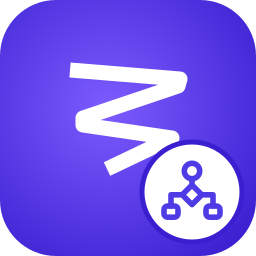
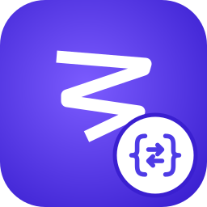
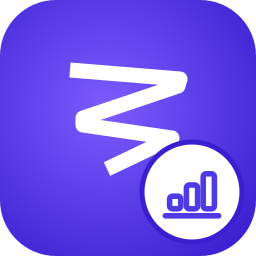

# Skills do CRM Datacrazy

Três skills para o Claude trabalhar com o [CRM Datacrazy](https://crm.datacrazy.io), escritas a partir de automações, integrações e painéis em produção:

| | Skill | Para que serve |
|---|---|---|
|  | `datacrazy-automacoes` | Construir, revisar e depurar automações (fluxos): todos os blocos e gatilhos, variáveis, JSON de importação, validador e organizador de layout. |
|  | `datacrazy-api` | Consumir a API REST e o MCP do Datacrazy sem estourar limite, sem perder registro na paginação e sem gastar requisição à toa. |
|  | `datacrazy-dashboards` | Montar painéis e relatórios sobre os dados do CRM: de onde vem cada número, como medir disparo, atendimento e venda, e como operar a ingestão. |

## Instalar no Claude Code (com atualização automática)

No Claude Code (terminal, aba Code do app desktop ou extensão do VS Code):

```
/plugin marketplace add marcosmirandaai/datacrazy-skills
/plugin install datacrazy-automacoes@datacrazy-skills
/plugin install datacrazy-api@datacrazy-skills
/plugin install datacrazy-dashboards@datacrazy-skills
```

Para receber as versões novas sozinho, ligue a atualização automática uma vez: `/plugin` → aba **Marketplaces** → `datacrazy-skills` → **Enable auto-update**. Sem isso, atualize quando quiser com `/plugin marketplace update datacrazy-skills`.

## Instalar no claude.ai

Baixe o `.zip` de cada skill na página de [Releases](https://github.com/marcosmirandaai/datacrazy-skills/releases/latest) e envie em **Configurações → Capacidades → Skills**. No claude.ai a skill não se atualiza sozinha: para uma versão nova, remova a antiga e envie o `.zip` novo.

## Sobre o conteúdo

- As regras foram medidas em contas reais. Os clientes aparecem como **Base A, B, C e D**, e as pessoas como **Atendente A, B…** e **Supervisora 1, 2**.
- Nenhuma chave de API acompanha as skills. Cada uma diz onde a sua chave entra (Parâmetro do sistema Secreto, `.env` do projeto).
- Quando a skill e o CRM divergirem, vale o CRM: o produto muda, e cada regra traz a data em que foi medida.

Este repositório é gerado automaticamente a partir do repositório de trabalho; mudanças feitas direto aqui são sobrescritas na próxima publicação. Sugestões e correções: abra uma issue.

## Licença

[MIT](LICENSE)
